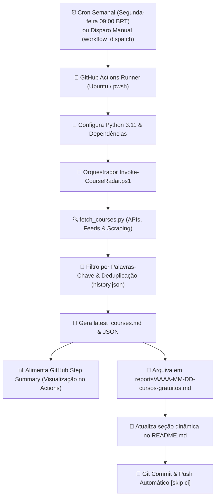

# 🛰️ Radar Semanal de Cursos Gratuitos EAD

[](https://github.com/davizeira/radar-cursos-ead/actions/workflows/radar-cursos.yml)


Robô inteligente de automação que executa **1 vez por semana** (toda segunda-feira às 09:00 BRT) via **GitHub Actions**, combinando **PowerShell** e **Python** para garimpar cursos gratuitos online (EAD), certificações oficiais e cupons 100% OFF nos principais pilares de interesse técnico e profissional.

---

## 🎯 Pilares Monitorados

O robô filtra os cursos ativamente com base nas palavras-chave configuradas em [`config/keywords.json`](./config/keywords.json):

| Ícone | Pilar de Conhecimento | Tópicos Centrais |
| :---: | :--- | :--- |
| 🌐 | **Infraestrutura, Redes & Segurança** | Redes de Computadores, Cisco, Active Directory, Windows Server, Linux, Cibersegurança, Firewalls, DNS, Cloud (Azure/AWS), Virtualização. |
| ⚙️ | **Desenvolvimento & DevOps** | Python, PowerShell, Git, GitHub Actions, Docker, CI/CD, Automação, Shell Scripting, Containers. |
| 🐘 | **Desenvolvimento Backend com PHP** | PHP moderno (8.x+), Laravel, PSRs, APIs RESTful, Bancos Relacionais (MySQL, PostgreSQL), Clean Code, MVC. |
| 🏛️ | **Governança de TI & Concursos** | COBIT, ITIL, LGPD, Gestão de TI, Engenharia de Software, Questões e Metodologias Ágeis (Cebraspe/FGV/FCC). |
| 🚗 | **Mecânica & Diagnóstico Automotivo** | Injeção Eletrônica, Diagnóstico com Scanners (OBD2/VCDS/KKL), Leitura de Sensores e Parâmetros de ECU, Eletroeletrônica Veicular. |

---

## 📡 Fontes de Dados Integradas

1. **Microsoft Learn Catalog API**: Módulos e trilhas oficiais em português com sandboxes práticas, crachás e preparação para certificações (Azure, PowerShell, Redes, AD, Python).
2. **Discudemy (Udemy 100% OFF)**: Garimpagem contínua de cupons de gratuidade integral para cursos da Udemy em TI, programação e eletrônica.
3. **Escola Virtual de Governo (EV.G / ENAP)**: Cursos oficiais com emissão gratuita de certificado Gov.br (Governança de TI, LGPD, Segurança da Informação, Gestão Pública).
4. **Cisco Skills For All & NetAcad**: Formações fundamentadas em Redes, Cibersegurança e Programação com certificação Cisco.
5. **IFRS MOOC (Instituto Federal)**: Cursos abertos com certificado MEC cobrindo Informática, Redes e Mecânica/Eletricidade Básica Automotiva.

---

## ⚙️ Como a Automação Funciona



---

## 🚀 Como Publicar este Repositório no GitHub

Para subir este projeto para a sua conta do GitHub:

1. **Crie o repositório no seu GitHub**:
   - Acesse [github.com/new](https://github.com/new)
   - Nome do repositório: `radar-cursos-ead`
   - Visibilidade: **Público** (para ter GitHub Actions gratuito ilimitado) ou **Privado**
   - **Não** inicialize com README, .gitignore ou licença (já configuramos tudo aqui!).

2. **Execute o assistente rápido em PowerShell** dentro desta pasta:
   ```powershell
   ./setup-github-repo.ps1
   ```
   *Ou faça manualmente via terminal:*
   ```powershell
   git init -b main
   git add .
   git commit -m "feat: setup inicial do radar de cursos ead com powershell e python"
   git remote add origin https://github.com/SEU_USUARIO/radar-cursos-ead.git
   git push -u origin main
   ```

3. **Habilitar permissões de escrita para o GitHub Actions Bot**:
   - No seu repositório no GitHub, vá em **Settings** > **Actions** > **General**.
   - Na seção **Workflow permissions**, selecione: **Read and write permissions**.
   - Marque a caixa **Allow GitHub Actions to create and approve pull requests**.
   - Clique em **Save**.

---

## 📋 Cursos em Destaque (Última Rodada)

<!-- COURSES_START -->

## Radar Semanal de Cursos Gratuitos EAD
> **Atualizado em:** 28/10/2026 a40 23:53 | **Total de Oportunidades Encontradas:** 17

Lista automatizada semanalmente via **GitHub Actions** cruzando APIs oficiais, feeds de cupons 100% OFF e instituicoes publicas de ensino.

### 🌐 Infraestrutura, Redes & Segurança (12)
| Curso | Plataforma / Fonte | Destaque | Link Direto |
| :--- | :--- | :---: | :---: |
| **Experimente com o Azure Machine Learning**<br><small>Escolha este módulo se quiser comparar modelos usando o machine learning automatizado, o MLflow e o painel de IA Responsável.</small> | `Microsoft Learn (Oficial Gratuito)` | `65 min - beginner` | [Acessar Curso](https://learn.microsoft.com/pt-br/training/modules/experiment-azure-machine-learning/?WT.mc_id=api_CatalogApi) |
| **Projetar e implementar o Azure ExpressRoute**<br><small>Você aprenderá a projetar e implementar o ExpressRoute do Azure, o Alcance Global do ExpressRoute, o ExpressRoute FastPath.</small> | `Microsoft Learn (Oficial Gratuito)` | `57 min - intermediate` | [Acessar Curso](https://learn.microsoft.com/pt-br/training/modules/design-implement-azure-expressroute/?WT.mc_id=api_CatalogApi) |
| **Proteger as interações do Microsoft 365 Copilot com o Microsoft Purview**<br><small>Ferramentas de IA como o Microsoft 365 Copilot criam novas maneiras de interagir com dados confidenciais, mas também introduzem novos riscos. Saiba como o Microsoft Purview ajuda você a aplicar controles de segurança e c...</small> | `Microsoft Learn (Oficial Gratuito)` | `54 min - intermediate` | [Acessar Curso](https://learn.microsoft.com/pt-br/training/modules/purview-ai-secure-copilot/?WT.mc_id=api_CatalogApi) |
| **Usar a IA com responsabilidade com a Segurança de Conteúdo do Microsoft Foundry**<br><small>À medida que a quantidade de conteúdo online gerado pelo usuário aumenta, também aumenta a necessidade de garantir que o material prejudicial seja moderado com eficácia. O recurso de Segurança de Conteúdo do Microsoft Fo...</small> | `Microsoft Learn (Oficial Gratuito)` | `70 min - intermediate` | [Acessar Curso](https://learn.microsoft.com/pt-br/training/modules/responsible-content-safety/?WT.mc_id=api_CatalogApi) |
| **Monitorar máquinas virtuais IaaS do Windows Server e instâncias híbridas**<br><small>Saiba como monitorar Windows Server VMs iaaS e instâncias híbridas usando Azure Monitor, Log Analytics workspaces, o Dependency Agent para mapas de serviço e a integração com Microsoft Operations Manager.</small> | `Microsoft Learn (Oficial Gratuito)` | `46 min - intermediate` | [Acessar Curso](https://learn.microsoft.com/pt-br/training/modules/monitor-windows-server-iaas-virtual-machines-hybrid-instances/?WT.mc_id=api_CatalogApi) |
| **Gerenciar Serviço de Kubernetes do Azure em Azure Local**<br><small>Prepare, implante, acesse e opere clusters AKS em implantações hiperconvergadas do Azure Local.</small> | `Microsoft Learn (Oficial Gratuito)` | `66 min - intermediate` | [Acessar Curso](https://learn.microsoft.com/pt-br/training/modules/manage-azure-kubernetes-service-azure-stack-hci/?WT.mc_id=api_CatalogApi) |
| **Monitorar respostas e eventos no Azure Cosmos DB for NoSQL**<br><small>Aprenderemos a usar um conjunto avançado de códigos de resposta REST retornados pela solicitação do Azure Cosmos DB para ajudá-lo a analisar possíveis problemas.</small> | `Microsoft Learn (Oficial Gratuito)` | `51 min - intermediate` | [Acessar Curso](https://learn.microsoft.com/pt-br/training/modules/monitor-responses-events-azure-cosmos-db-sql-api/?WT.mc_id=api_CatalogApi) |
| **Implementar a segurança de rede de VMs IaaS do Windows Server**<br><small>Saiba como implementar a segurança de rede para Windows Server VMs IaaS usando NSGs (grupos de segurança de rede), Firewall do Azure, firewall de Windows Defender e Observador de Rede do Azure para captura de tráfego e r...</small> | `Microsoft Learn (Oficial Gratuito)` | `64 min - intermediate` | [Acessar Curso](https://learn.microsoft.com/pt-br/training/modules/implement-windows-server-iaas-virtual-machine-network-security/?WT.mc_id=api_CatalogApi) |
| **Compartilhar conhecimento dentro das equipes**<br><small>Saiba como compartilhar conhecimento efetivamente em equipes de desenvolvimento usando o Wikis do Azure DevOps, a documentação do GitHub e a integração do Microsoft Teams. Explore estratégias de documentação, criação e g...</small> | `Microsoft Learn (Oficial Gratuito)` | `65 min - advanced` | [Acessar Curso](https://learn.microsoft.com/pt-br/training/modules/share-knowledge-within-teams/?WT.mc_id=api_CatalogApi) |
| **Governança, proteções e operações**<br><small>Os sistemas de agente devem operar dentro de estruturas de governança claras para garantir a segurança, a conformidade e a responsabilidade. No ecossistema GitHub, a governança é imposta por meio de controles de repositó...</small> | `Microsoft Learn (Oficial Gratuito)` | `45 min - intermediate` | [Acessar Curso](https://learn.microsoft.com/pt-br/training/modules/governance-guardrails-operations/?WT.mc_id=api_CatalogApi) |
| **Cisco Networking Basics & Redes de Computadores**<br><small>Fundamentos essenciais de redes, arquitetura TCP/IP, roteadores, switches e enderecamento IP.</small> | `Cisco Skills For All` | `Certificado Oficial Cisco` | [Acessar Curso](https://skillsforall.com/course/networking-basics) |
| **Cisco Cybersecurity Essentials**<br><small>Conceitos fundamentais de seguranca, taticas de defesa, ameacas ciberneticas e boas praticas.</small> | `Cisco Skills For All` | `Certificado Oficial Cisco` | [Acessar Curso](https://skillsforall.com/course/cybersecurity-essentials) |

### ⚙️ Desenvolvimento & DevOps (2)
| Curso | Plataforma / Fonte | Destaque | Link Direto |
| :--- | :--- | :---: | :---: |
| **Introdução aos princípios de DevOps para aprendizado de máquina**<br><small>Saiba mais sobre o DevOps para machine learning, operações de machine learning e MLOps.</small> | `Microsoft Learn (Oficial Gratuito)` | `33 min - beginner` | [Acessar Curso](https://learn.microsoft.com/pt-br/training/modules/introduction-development-operations-principles-for-machine-learn/?WT.mc_id=api_CatalogApi) |
| **Python Essentials 1 (Cisco / Python Institute)**<br><small>Preparatorio oficial OpenEDG para a certificacao PCEP (Certified Entry-Level Python Programmer).</small> | `Cisco Skills For All` | `Certificado Oficial Cisco` | [Acessar Curso](https://skillsforall.com/course/python-essentials-1) |

### 🐘 Desenvolvimento Backend com PHP (1)
| Curso | Plataforma / Fonte | Destaque | Link Direto |
| :--- | :--- | :---: | :---: |
| **Modelagem de Dados e Bancos Relacionais SQL**<br><small>Diagrama de entidade-relacionamento (DER), normalizacao, chaves e fundamentos de SQL.</small> | `Fundacao Bradesco - Escola Virtual` | `Certificado Fundacao Bradesco` | [Acessar Curso](https://www.ev.org.br/cursos/modelagem-de-dados) |

### 🏛️ Governança de TI & Estudos para Concursos (0)
_Nenhum novo curso detectado nesta categoria nesta rodada._

### 🚗 Mecânica & Diagnóstico Automotivo (2)
| Curso | Plataforma / Fonte | Destaque | Link Direto |
| :--- | :--- | :---: | :---: |
| **Adicionar lógica de decisão ao código em C#**<br><small>Saiba como ramificar o caminho de execução de seu código avaliando expressões boolianas.</small> | `Microsoft Learn (Oficial Gratuito)` | `43 min - beginner` | [Acessar Curso](https://learn.microsoft.com/pt-br/training/modules/csharp-if-elseif-else/?WT.mc_id=api_CatalogApi) |
| **Eletricidade Basica Automotiva e Circuitos**<br><small>Conceitos de grandezas eletricas, circuitos, fusiveis, reles e leitura de esquemas eletricos.</small> | `IFRS MOOC (Instituto Federal)` | `Certificado Gratuito MEC` | [Acessar Curso](https://mooc.ifrs.edu.br/course/index.php?categoryid=11) |


<!-- COURSES_END -->

---

## 🛠️ Personalização

Para adicionar ou remover termos de busca, edite o arquivo [`config/keywords.json`](./config/keywords.json):

```json
{
  "categories": {
    "infra_redes_seguranca": {
      "name": "Infraestrutura, Redes & Segurança",
      "icon": "🌐",
      "keywords": ["rede", "cisco", "active directory", "linux", "firewall", "azure"]
    }
  }
}
```

---

## 📜 Licença

Distribuído sob a licença [MIT](./LICENSE).


