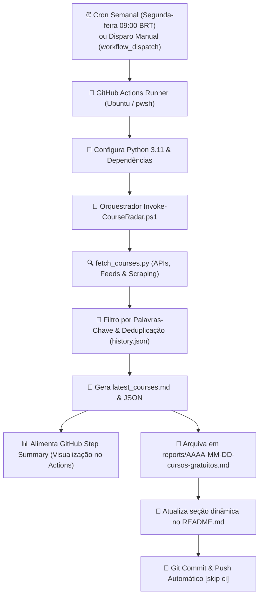

# 🛰️ Radar Semanal de Cursos Gratuitos EAD

[](https://github.com/davizeira/radar-cursos-ead/actions/workflows/radar-cursos.yml)


Robô inteligente de automação que executa **1 vez por semana** (toda segunda-feira às 09:00 BRT) via **GitHub Actions**, combinando **PowerShell** e **Python** para garimpar cursos gratuitos online (EAD), certificações oficiais e cupons 100% OFF nos principais pilares de interesse técnico e profissional.

---

## 🎯 Pilares Monitorados

O robô filtra os cursos ativamente com base nas palavras-chave configuradas em [`config/keywords.json`](./config/keywords.json):

| Ícone | Pilar de Conhecimento | Tópicos Centrais |
| :---: | :--- | :--- |
| 🌐 | **Infraestrutura, Redes & Segurança** | Redes de Computadores, Cisco, Active Directory, Windows Server, Linux, Cibersegurança, Firewalls, DNS, Cloud (Azure/AWS), Virtualização. |
| ⚙️ | **Desenvolvimento & DevOps** | Python, PowerShell, Git, GitHub Actions, Docker, CI/CD, Automação, Shell Scripting, Containers. |
| 🐘 | **Desenvolvimento Backend com PHP** | PHP moderno (8.x+), Laravel, PSRs, APIs RESTful, Bancos Relacionais (MySQL, PostgreSQL), Clean Code, MVC. |
| 🏛️ | **Governança de TI & Concursos** | COBIT, ITIL, LGPD, Gestão de TI, Engenharia de Software, Questões e Metodologias Ágeis (Cebraspe/FGV/FCC). |
| 🚗 | **Mecânica & Diagnóstico Automotivo** | Injeção Eletrônica, Diagnóstico com Scanners (OBD2/VCDS/KKL), Leitura de Sensores e Parâmetros de ECU, Eletroeletrônica Veicular. |

---

## 📡 Fontes de Dados Integradas

1. **Microsoft Learn Catalog API**: Módulos e trilhas oficiais em português com sandboxes práticas, crachás e preparação para certificações (Azure, PowerShell, Redes, AD, Python).
2. **Discudemy (Udemy 100% OFF)**: Garimpagem contínua de cupons de gratuidade integral para cursos da Udemy em TI, programação e eletrônica.
3. **Escola Virtual de Governo (EV.G / ENAP)**: Cursos oficiais com emissão gratuita de certificado Gov.br (Governança de TI, LGPD, Segurança da Informação, Gestão Pública).
4. **Cisco Skills For All & NetAcad**: Formações fundamentadas em Redes, Cibersegurança e Programação com certificação Cisco.
5. **IFRS MOOC (Instituto Federal)**: Cursos abertos com certificado MEC cobrindo Informática, Redes e Mecânica/Eletricidade Básica Automotiva.

---

## ⚙️ Como a Automação Funciona



---

## 🚀 Como Publicar este Repositório no GitHub

Para subir este projeto para a sua conta do GitHub:

1. **Crie o repositório no seu GitHub**:
   - Acesse [github.com/new](https://github.com/new)
   - Nome do repositório: `radar-cursos-ead`
   - Visibilidade: **Público** (para ter GitHub Actions gratuito ilimitado) ou **Privado**
   - **Não** inicialize com README, .gitignore ou licença (já configuramos tudo aqui!).

2. **Execute o assistente rápido em PowerShell** dentro desta pasta:
   ```powershell
   ./setup-github-repo.ps1
   ```
   *Ou faça manualmente via terminal:*
   ```powershell
   git init -b main
   git add .
   git commit -m "feat: setup inicial do radar de cursos ead com powershell e python"
   git remote add origin https://github.com/SEU_USUARIO/radar-cursos-ead.git
   git push -u origin main
   ```

3. **Habilitar permissões de escrita para o GitHub Actions Bot**:
   - No seu repositório no GitHub, vá em **Settings** > **Actions** > **General**.
   - Na seção **Workflow permissions**, selecione: **Read and write permissions**.
   - Marque a caixa **Allow GitHub Actions to create and approve pull requests**.
   - Clique em **Save**.

---

## 📋 Cursos em Destaque (Última Rodada)

<!-- COURSES_START -->

### 🌐 Infraestrutura, Redes & Segurança
| Curso | Plataforma / Fonte | Destaque | Link Direto |
| :--- | :--- | :---: | :---: |
| **Cisco Networking Basics & Redes de Computadores**<br><small>Fundamentos essenciais de redes, arquitetura TCP/IP, roteadores, switches e endereçamento IP.</small> | `Cisco Skills For All` | `Certificado Oficial Cisco` | [Acessar Curso 🚀](https://skillsforall.com/course/networking-basics) |
| **Cisco Cybersecurity Essentials**<br><small>Conceitos fundamentais de segurança, táticas de defesa, ameaças cibernéticas e boas práticas corporativas.</small> | `Cisco Skills For All` | `Certificado Oficial Cisco` | [Acessar Curso 🚀](https://skillsforall.com/course/cybersecurity-essentials) |
| **Segurança em Tecnologia da Informação**<br><small>Fundamentos de segurança de redes, políticas de acesso, criptografia e proteção de infraestruturas.</small> | `Fundação Bradesco - Escola Virtual` | `Certificado Fundação Bradesco` | [Acessar Curso 🚀](https://www.ev.org.br/cursos/seguranca-em-tecnologia-da-informacao) |

### ⚙️ Desenvolvimento & DevOps
| Curso | Plataforma / Fonte | Destaque | Link Direto |
| :--- | :--- | :---: | :---: |
| **Python Essentials 1 (Cisco / Python Institute)**<br><small>Preparatório oficial OpenEDG para a certificação PCEP (Certified Entry-Level Python Programmer).</small> | `Cisco Skills For All` | `Certificado Oficial Cisco` | [Acessar Curso 🚀](https://skillsforall.com/course/python-essentials-1) |
| **Automatizar tarefas com PowerShell**<br><small>Trilha prática oficial do Microsoft Learn sobre scripts, módulos e pipelines PowerShell.</small> | `Microsoft Learn (Oficial Gratuito)` | `Módulos Interativos` | [Acessar Curso 🚀](https://learn.microsoft.com/pt-br/training/modules/introduction-to-powershell/) |

### 🐘 Desenvolvimento Backend com PHP
| Curso | Plataforma / Fonte | Destaque | Link Direto |
| :--- | :--- | :---: | :---: |
| **Modelagem de Dados e Bancos Relacionais SQL**<br><small>Diagrama de entidade-relacionamento (DER), normalização, chaves e fundamentos de SQL.</small> | `Fundação Bradesco - Escola Virtual` | `Certificado Fundação Bradesco` | [Acessar Curso 🚀](https://www.ev.org.br/cursos/modelagem-de-dados) |

### 🏛️ Governança de TI & Estudos para Concursos
| Curso | Plataforma / Fonte | Destaque | Link Direto |
| :--- | :--- | :---: | :---: |
| **Privacidade e Proteção de Dados Pessoais (LGPD)**<br><small>Curso oficial ENAP sobre diretrizes da Lei Geral de Proteção de Dados e conformidade.</small> | `Escola Virtual Gov (EV.G / ENAP)` | `Certificado Grátis Gov.br` | [Acessar Curso 🚀](https://www.escolavirtual.gov.br/catalogo) |

### 🚗 Mecânica & Diagnóstico Automotivo
| Curso | Plataforma / Fonte | Destaque | Link Direto |
| :--- | :--- | :---: | :---: |
| **Eletricidade Básica Automotiva e Circuitos**<br><small>Conceitos de grandezas elétricas, circuitos, fusíveis, relés e leitura de esquemas automotivos.</small> | `IFRS MOOC (Instituto Federal)` | `Certificado Gratuito MEC` | [Acessar Curso 🚀](https://mooc.ifrs.edu.br/course/index.php?categoryid=11) |

<!-- COURSES_END -->

---

## 🛠️ Personalização

Para adicionar ou remover termos de busca, edite o arquivo [`config/keywords.json`](./config/keywords.json):

```json
{
  "categories": {
    "infra_redes_seguranca": {
      "name": "Infraestrutura, Redes & Segurança",
      "icon": "🌐",
      "keywords": ["rede", "cisco", "active directory", "linux", "firewall", "azure"]
    }
  }
}
```

---

## 📜 Licença

Distribuído sob a licença [MIT](./LICENSE).
