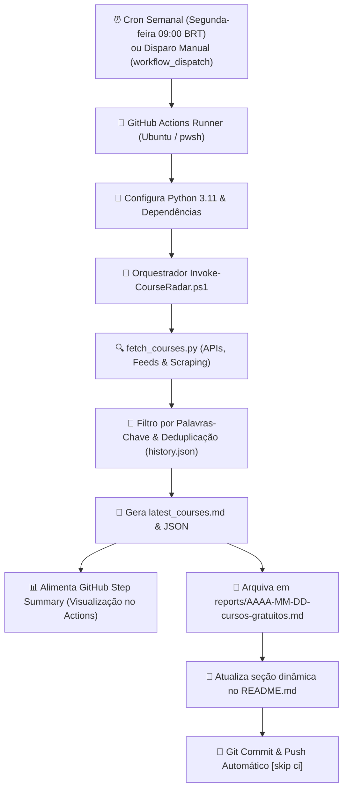

# 🛰️ Radar Semanal de Cursos Gratuitos EAD

[](https://github.com/davizeira/radar-cursos-ead/actions/workflows/radar-cursos.yml)


Robô inteligente de automação que executa **1 vez por semana** (toda segunda-feira às 09:00 BRT) via **GitHub Actions**, combinando **PowerShell** e **Python** para garimpar cursos gratuitos online (EAD), certificações oficiais e cupons 100% OFF nos principais pilares de interesse técnico e profissional.

---

## 🎯 Pilares Monitorados

O robô filtra os cursos ativamente com base nas palavras-chave configuradas em [`config/keywords.json`](./config/keywords.json):

| Ícone | Pilar de Conhecimento | Tópicos Centrais |
| :---: | :--- | :--- |
| 🌐 | **Infraestrutura, Redes & Segurança** | Redes de Computadores, Cisco, Active Directory, Windows Server, Linux, Cibersegurança, Firewalls, DNS, Cloud (Azure/AWS), Virtualização. |
| ⚙️ | **Desenvolvimento & DevOps** | Python, PowerShell, Git, GitHub Actions, Docker, CI/CD, Automação, Shell Scripting, Containers. |
| 🐘 | **Desenvolvimento Backend com PHP** | PHP moderno (8.x+), Laravel, PSRs, APIs RESTful, Bancos Relacionais (MySQL, PostgreSQL), Clean Code, MVC. |
| 🏛️ | **Governança de TI & Concursos** | COBIT, ITIL, LGPD, Gestão de TI, Engenharia de Software, Questões e Metodologias Ágeis (Cebraspe/FGV/FCC). |
| 🚗 | **Mecânica & Diagnóstico Automotivo** | Injeção Eletrônica, Diagnóstico com Scanners (OBD2/VCDS/KKL), Leitura de Sensores e Parâmetros de ECU, Eletroeletrônica Veicular. |

---

## 📡 Fontes de Dados Integradas

1. **Microsoft Learn Catalog API**: Módulos e trilhas oficiais em português com sandboxes práticas, crachás e preparação para certificações (Azure, PowerShell, Redes, AD, Python).
2. **Discudemy (Udemy 100% OFF)**: Garimpagem contínua de cupons de gratuidade integral para cursos da Udemy em TI, programação e eletrônica.
3. **Escola Virtual de Governo (EV.G / ENAP)**: Cursos oficiais com emissão gratuita de certificado Gov.br (Governança de TI, LGPD, Segurança da Informação, Gestão Pública).
4. **Cisco Skills For All & NetAcad**: Formações fundamentadas em Redes, Cibersegurança e Programação com certificação Cisco.
5. **IFRS MOOC (Instituto Federal)**: Cursos abertos com certificado MEC cobrindo Informática, Redes e Mecânica/Eletricidade Básica Automotiva.

---

## ⚙️ Como a Automação Funciona



---

## 🚀 Como Publicar este Repositório no GitHub

Para subir este projeto para a sua conta do GitHub:

1. **Crie o repositório no seu GitHub**:
   - Acesse [github.com/new](https://github.com/new)
   - Nome do repositório: `radar-cursos-ead`
   - Visibilidade: **Público** (para ter GitHub Actions gratuito ilimitado) ou **Privado**
   - **Não** inicialize com README, .gitignore ou licença (já configuramos tudo aqui!).

2. **Execute o assistente rápido em PowerShell** dentro desta pasta:
   ```powershell
   ./setup-github-repo.ps1
   ```
   *Ou faça manualmente via terminal:*
   ```powershell
   git init -b main
   git add .
   git commit -m "feat: setup inicial do radar de cursos ead com powershell e python"
   git remote add origin https://github.com/SEU_USUARIO/radar-cursos-ead.git
   git push -u origin main
   ```

3. **Habilitar permissões de escrita para o GitHub Actions Bot**:
   - No seu repositório no GitHub, vá em **Settings** > **Actions** > **General**.
   - Na seção **Workflow permissions**, selecione: **Read and write permissions**.
   - Marque a caixa **Allow GitHub Actions to create and approve pull requests**.
   - Clique em **Save**.

---

## 📋 Cursos em Destaque (Última Rodada)

<!-- COURSES_START -->

## Radar Semanal de Cursos Gratuitos EAD
> **Atualizado em:** 29/10/2026 a20 03:09 | **Total de Oportunidades Encontradas:** 12

Lista automatizada semanalmente via **GitHub Actions** cruzando APIs oficiais, feeds de cupons 100% OFF e instituicoes publicas de ensino.

### 🌐 Infraestrutura, Redes & Segurança (12)
| Curso | Plataforma / Fonte | Destaque | Link Direto |
| :--- | :--- | :---: | :---: |
| **Avaliar bancos de dados do SQL Server para migração para o SQL do Azure**<br><small>Conheça várias ferramentas de avaliação que facilitam a migração de bancos de dados para o Azure, incluindo o SQL Server habilitado pelo Azure Arc, o Azure Migrate e o Serviço de Migração de Banco de Dados do Azure.</small> | `Microsoft Learn (Oficial Gratuito)` | `45 min - intermediate` | [Acessar Curso](https://learn.microsoft.com/pt-br/training/modules/assess-sql-server-databases-for-migration-to-azure-sql/?WT.mc_id=api_CatalogApi) |
| **Migrações do Azure DevOps para o GitHub Enterprise Parte III – Teste de Migração e Migração para Produção**<br><small>Saiba como concluir os estágios finais da migração do Azure DevOps para o GitHub Enterprise. Este módulo ajuda você a testar seu plano de migração com repositórios reais e realizar uma migração de produção suave, mantend...</small> | `Microsoft Learn (Oficial Gratuito)` | `19 min - intermediate` | [Acessar Curso](https://learn.microsoft.com/pt-br/training/modules/ado-github-migrations-3/?WT.mc_id=api_CatalogApi) |
| **Adicionar e dimensionar discos nas máquinas virtuais do Azure**<br><small>Saiba mais sobre suas opções de armazenamento de máquina virtual e como escolher entre os discos padrão e premium, gerenciados e não gerenciados para sua máquina virtual do Azure.</small> | `Microsoft Learn (Oficial Gratuito)` | `36 min - intermediate` | [Acessar Curso](https://learn.microsoft.com/pt-br/training/modules/add-and-size-disks-in-azure-virtual-machines/?WT.mc_id=api_CatalogApi) |
| **Gerenciar o acesso à Área de Trabalho Virtual do Azure**<br><small>Gerenciar o acesso à Área de Trabalho Virtual do Azure</small> | `Microsoft Learn (Oficial Gratuito)` | `40 min - intermediate` | [Acessar Curso](https://learn.microsoft.com/pt-br/training/modules/manage-access/?WT.mc_id=api_CatalogApi) |
| **Migrar instâncias locais do Windows Server para máquinas virtuais de IaaS do Azure**<br><small>Você pode planejar uma migração e selecionar as ferramentas de migração de servidor apropriadas. Você também aprenderá a usar as Migrações para Azure, como avaliar servidores físicos e como migrar esses servidores.</small> | `Microsoft Learn (Oficial Gratuito)` | `41 min - intermediate` | [Acessar Curso](https://learn.microsoft.com/pt-br/training/modules/migrate-premises-windows-server-instances-azure-iaas-virtual-machines/?WT.mc_id=api_CatalogApi) |
| **Hospedar um aplicativo Web com o Serviço de Aplicativo do Azure**<br><small>Crie um site usando C#, Java, Python ou Node.js e implante-o por meio da plataforma de aplicativo Web hospedada no Serviço de Aplicativo do Azure.</small> | `Microsoft Learn (Oficial Gratuito)` | `31 min - beginner` | [Acessar Curso](https://learn.microsoft.com/pt-br/training/modules/host-a-web-app-with-azure-app-service/?WT.mc_id=api_CatalogApi) |
| **Migrações do Azure DevOps para o GitHub Enterprise Parte II – Avaliação do Ambiente de Origem e Configuração do Ambiente de Destino**<br><small>Este módulo orienta você pelas etapas críticas de preparação para migrar do AZure DevOps (ADO) para o GitHub Enterprise Cloud (GHEC). Você aprenderá a analisar a estrutura e as dependências do ambiente do ADO e traduzir ...</small> | `Microsoft Learn (Oficial Gratuito)` | `26 min - intermediate` | [Acessar Curso](https://learn.microsoft.com/pt-br/training/modules/ado-github-migrations-2/?WT.mc_id=api_CatalogApi) |
| **Implementar controles de segurança para aplicativos de funções Azure e aplicativos lógicos**<br><small>Implementar controles de segurança para aplicativos de funções Azure e aplicativos lógicos. Configure a autenticação e a autorização, as identidades gerenciadas, a integração de rede virtual e os pontos de extremidade pr...</small> | `Microsoft Learn (Oficial Gratuito)` | `28 min - intermediate` | [Acessar Curso](https://learn.microsoft.com/pt-br/training/modules/implement-security-controls-function-logic-apps/?WT.mc_id=api_CatalogApi) |
| **Avaliar estratégias de migração para o SQL do Azure**<br><small>Avaliar estratégias de migração para o SQL do Azure</small> | `Microsoft Learn (Oficial Gratuito)` | `22 min - intermediate` | [Acessar Curso](https://learn.microsoft.com/pt-br/training/modules/evaluate-strategies-for-migrating-to-azure-sql/?WT.mc_id=api_CatalogApi) |
| **Migrações de design**<br><small>Design e soluções de migração recomendadas do Azure Architect.</small> | `Microsoft Learn (Oficial Gratuito)` | `46 min - advanced` | [Acessar Curso](https://learn.microsoft.com/pt-br/training/modules/design-migrations/?WT.mc_id=api_CatalogApi) |
| **Implementar o Azure Cosmos DB para operações de ponto NoSQL**<br><small>Escreva código para criar, ler, atualizar e excluir itens no Azure Cosmos DB para NoSQL.</small> | `Microsoft Learn (Oficial Gratuito)` | `45 min - intermediate` | [Acessar Curso](https://learn.microsoft.com/pt-br/training/modules/implement-azure-cosmos-db-sql-api-point-operations/?WT.mc_id=api_CatalogApi) |
| **Introdução à IA generativa no Banco de Dados do Azure para PostgreSQL**<br><small>Use a IA generativa no Banco de Dados do Azure para PostgreSQL.</small> | `Microsoft Learn (Oficial Gratuito)` | `57 min - intermediate` | [Acessar Curso](https://learn.microsoft.com/pt-br/training/modules/get-started-generative-ai-azure-database-postgresql/?WT.mc_id=api_CatalogApi) |

### ⚙️ Desenvolvimento & DevOps (0)
_Nenhum novo curso detectado nesta categoria nesta rodada._

### 🐘 Desenvolvimento Backend com PHP (0)
_Nenhum novo curso detectado nesta categoria nesta rodada._

### 🏛️ Governança de TI & Estudos para Concursos (0)
_Nenhum novo curso detectado nesta categoria nesta rodada._

### 🚗 Mecânica & Diagnóstico Automotivo (0)
_Nenhum novo curso detectado nesta categoria nesta rodada._


<!-- COURSES_END -->

---

## 🛠️ Personalização

Para adicionar ou remover termos de busca, edite o arquivo [`config/keywords.json`](./config/keywords.json):

```json
{
  "categories": {
    "infra_redes_seguranca": {
      "name": "Infraestrutura, Redes & Segurança",
      "icon": "🌐",
      "keywords": ["rede", "cisco", "active directory", "linux", "firewall", "azure"]
    }
  }
}
```

---

## 📜 Licença

Distribuído sob a licença [MIT](./LICENSE).


